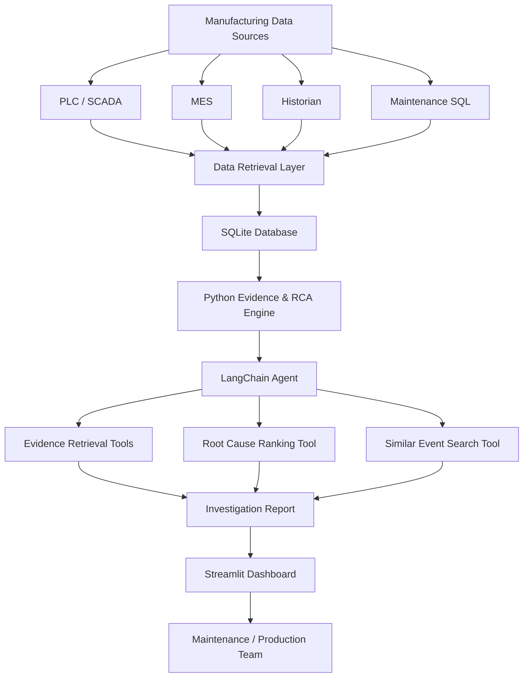

# 🔎 -Downtime-Investigator-Root-Cause-Intelligence-Agent
 ### Agentic AI for Smart Manufacturing | Industry 4.0 

An AI-powered manufacturing downtime investigation solution that correlates **PLC/SCADA alarms, MES production context, Historian time-series signals and SQL-based maintenance records** to identify potential equipment failure patterns, rank root-cause hypotheses and recommend evidence-based investigation actions.

Built with **Python, LangChain, OpenAI API, SQLite, Pandas and Streamlit**, this project demonstrates how Agentic AI can support maintenance and production teams in moving from reactive downtime reporting towards intelligent, evidence-driven problem investigation.

> **Project status:** Proof of Concept (PoC)  
> **Data:** Simulated manufacturing data  
> **Architecture:** Read-only decision-support application  
> **Domain:** Battery Manufacturing | Digital Manufacturing | Smart Factory | Industry 4.0

---

## 📌 1. Business Problem

Manufacturing organizations generate large volumes of operational data across PLCs, SCADA, MES, historians, maintenance systems and production databases.

However, these systems often operate in silos.

When an equipment breakdown or production stoppage occurs, maintenance and production teams typically need to manually investigate multiple sources to understand:

- What happened before the machine stopped?
- Which PLC alarm or interlock was triggered?
- Did motor current, vibration or temperature deviate from normal behaviour?
- Was there a material shortage or production-order-related issue?
- Have similar breakdowns occurred previously?
- What is the most probable failure mechanism?
- What should the maintenance team investigate first?

Traditional OEE dashboards can identify where production losses occur, but they generally do not provide a complete, evidence-linked investigation of why a particular event occurred.

### The proposed solution

The Downtime Investigator & Root Cause Intelligence Agent uses Agentic AI to retrieve and correlate multi-source manufacturing data, evaluate potential failure hypotheses and generate structured investigation reports.

**The objective is to help manufacturing teams investigate downtime faster, prioritize maintenance activities and make better operational decisions.**

---

## 🎯 2. Project Objectives

1. Develop an AI-powered downtime investigation assistant for manufacturing operations.
2. Integrate simulated PLC, MES, Historian and SQL maintenance data feeds.
3. Correlate equipment alarms, process signals and production context around a downtime event.
4. Identify abnormal operating patterns preceding machine stoppages.
5. Rank potential root-cause hypotheses using evidence-based rules.
6. Use an LLM-powered agent to interpret evidence and generate investigation reports.
7. Recommend diagnostic checks and appropriate follow-up ownership.
8. Establish a foundation for future integration with real manufacturing systems.

---

## 🏗️ 3. Solution Architecture

The solution follows a multi-source data retrieval and Agentic AI reasoning architecture.



### Investigation workflow

1. A user selects a downtime event or submits an investigation request.
2. The agent retrieves the associated downtime event.
3. The evidence engine fetches PLC alarms, MES context, Historian readings and maintenance records.
4. Python-based rules evaluate the available evidence and rank candidate causes.
5. The LangChain agent uses its tools to interpret the evidence and compare hypotheses.
6. The agent generates a structured investigation report.
7. Maintenance and production teams review the findings and decide on the next action.

### Key design principle

The LLM is responsible for investigation orchestration and evidence interpretation. Deterministic Python functions perform data retrieval, calculations and rule-based scoring.

This hybrid approach makes the investigation more transparent and reduces the risk of unsupported AI conclusions.

---

## ⚙️ 4. Key Features

| Feature | Description |
|---|---|
| Multi-source data correlation | Combines PLC, MES, Historian and maintenance data |
| PLC alarm investigation | Identifies relevant machine alarms and event sequences |
| Historian signal analysis | Examines motor current, vibration, temperature and sensor behaviour |
| MES production context | Evaluates product, production order, production rate and material status |
| Root-cause hypothesis ranking | Ranks candidate failure mechanisms using deterministic evidence rules |
| Similar-event investigation | Retrieves previous incidents involving the same machine or production line |
| Agentic AI reasoning | Uses LangChain tools to investigate and explain evidence |
| Investigation reporting | Produces structured findings, confidence rationale and recommended checks |
| Interactive dashboard | Provides an intuitive Streamlit interface for event selection and analysis |

---

## 🤖 5. Specialist Agent Capabilities

The first version implements one specialist agent: **Downtime Investigator & Root Cause Intelligence Agent**.

The agent has access to the following tools:

| Tool | Purpose |
|---|---|
| `list_recent_downtime_events` | Retrieves available downtime events |
| `retrieve_multisource_evidence` | Fetches PLC, MES, Historian and maintenance evidence |
| `rank_root_cause_hypotheses` | Evaluates and ranks potential causes |
| `find_similar_downtime_events` | Finds comparable incidents and previous maintenance actions |

The agent uses these tools to prepare an investigation report containing:

- Incident summary
- Event timeline
- PLC alarm evidence
- MES production context
- Historian signal deviations
- Maintenance history
- Ranked root-cause hypotheses
- Confidence rationale
- Recommended diagnostic checks
- Suggested responsible team
- Missing information required for validation

**Important:** The agent provides candidate root causes, not automatically confirmed failure diagnoses. Final validation remains with qualified plant personnel.

---

## 📊 6. Simulated Manufacturing Data

Since real plant data is not required for this PoC, the project includes a synthetic battery-manufacturing dataset.

The generator creates 18 simulated downtime incidents across Assembly, Formation and Finishing operations.

### Data feeds

| Dataset | Description | Example fields |
|---|---|---|
| `downtime_events.csv` | Equipment downtime records | Event ID, machine, line, start time, duration |
| `plc_alarms.csv` | PLC/SCADA alarm records | Alarm code, timestamp, severity, alarm description |
| `historian_signals.csv` | Time-series process measurements | Motor current, vibration, bearing temperature, rectifier temperature |
| `mes_context.csv` | Production execution context | Production order, product, planned rate, actual rate, material status |
| `maintenance_work_orders.csv` | Maintenance history | Work-order ID, failure code, technician notes, corrective action |

The same simulated records are also stored in a SQLite database:

`data/plant.db`

### Simulated root-cause scenarios

| Event ID | Scenario | Key evidence |
|---|---|---|
| DT-0001 | Motor overload | Increased motor current and PLC overload alarm |
| DT-0002 | Bearing vibration | Increased vibration and bearing temperature |
| DT-0003 | Sensor misread | Abnormal photoeye transition rate |
| DT-0004 | Material shortage | MES material shortage and reduced buffer level |
| DT-0005 | Rectifier overtemperature | High rectifier temperature and PLC alarm |

Additional events are generated to test the same failure signatures across different machines and production lines.

> All readings, alarms, work orders, equipment names and incident records are simulated. They are intended for software demonstration and development, not for actual equipment operation or maintenance decisions.

---

## 🛠️ 7. Technology Stack

| Technology | Purpose |
|---|---|
| Python | Core application development |
| LangChain | Agent orchestration and tool calling |
| LangChain OpenAI integration | LLM connectivity |
| OpenAI API | Natural-language reasoning and investigation |
| Pandas | Data processing and analysis |
| NumPy | Synthetic data generation |
| SQLite | Simulated manufacturing data storage |
| Streamlit | Interactive application and dashboard |
| Plotly | Historian signal visualization |
| python-dotenv | Environment variable management |

---

## 📁 8. Project Structure

```text
downtime_rca_agent/
│
├── app.py
│
├── agent.py
│
├── rca_engine.py
│
├── generate_data.py
│
├── requirements.txt
│
├── .env.example
│
├── .gitignore
│
├── README.md
│
└── data/
    ├── downtime_events.csv
    ├── plc_alarms.csv
    ├── historian_signals.csv
    ├── mes_context.csv
    ├── maintenance_work_orders.csv
    └── plant.db
```

### Core Python modules

**`generate_data.py`**

Generates simulated manufacturing data for the five data feeds and creates the SQLite database.

**`rca_engine.py`**

Implements data retrieval, evidence correlation, rule-based root-cause ranking and similar-event search.

**`agent.py`**

Defines the LangChain agent, its tools and investigation instructions.

**`app.py`**

Implements the Streamlit dashboard and provides the user interface for investigation.

---

## 🚀 9. Installation & Setup

### Prerequisites

- Python 3.10 or later
- Visual Studio Code
- Python extension for VS Code
- Git
- OpenAI API key for LLM-powered investigation

### Step 1: Clone the repository

```bash
git clone https://github.com/YOUR_USERNAME/YOUR_REPOSITORY.git
```

Navigate into the project directory:

```bash
cd YOUR_REPOSITORY
```

### Step 2: Create a virtual environment

```bash
python -m venv .venv
```

Activate it.

**Windows PowerShell:**

```powershell
.\.venv\Scripts\Activate.ps1
```

**Linux / macOS:**

```bash
source .venv/bin/activate
```

### Step 3: Install dependencies

```bash
python -m pip install --upgrade pip
pip install -r requirements.txt
```

### Step 4: Generate simulated data

```bash
python generate_data.py
```

This generates the five CSV files and SQLite database under the `data/` directory.

### Step 5: Configure OpenAI API credentials

Create a `.env` file in the project root.

```env
OPENAI_API_KEY=your_openai_api_key
OPENAI_MODEL=gpt-4.1-mini
```

Replace the placeholder with your API key and use a model available to your API account.

**Security:** Never commit your `.env` file or expose API credentials in source code, screenshots or public repositories.

### Step 6: Launch the application

```bash
streamlit run app.py
```

Open the local application:

```text
http://localhost:8501
```

---

## 🧪 10. Sample Investigation Prompts

Once the application is running, try the following prompts.

**Scenario 1: Motor overload investigation**

```text
Investigate DT-0001.

Analyze the PLC alarm, motor current trend,
historian readings and maintenance history.

Identify the strongest root-cause hypothesis,
supporting evidence, data gaps and recommended
maintenance checks.
```

**Scenario 2: Material shortage investigation**

```text
Investigate DT-0004.

Correlate MES material status, production context
and historian buffer-level readings.

Explain whether the evidence supports a material
starvation hypothesis and what additional
information is required to confirm it.
```

**Scenario 3: Rectifier overtemperature**

```text
Investigate DT-0005.

Analyze the rectifier temperature trend and PLC
alarm sequence.

Identify possible contributing factors and
recommend safe diagnostic checks for the
maintenance and electrical teams.
```

**Scenario 4: Similar breakdown analysis**

```text
Compare DT-0001 and DT-0011.

Identify similarities in machine behaviour,
alarm signatures and historical maintenance
actions.

Recommend what should be checked before
replacing any equipment component.
```

---

## 📈 11. Expected Business Value

The solution demonstrates how Agentic AI can support manufacturing operational excellence.

| Business area | Potential value |
|---|---|
| Downtime investigation | Faster access to relevant evidence across systems |
| Maintenance productivity | Reduced manual data collection and analysis |
| Root-cause analysis | Structured and consistent investigation approach |
| Equipment reliability | Better visibility of recurring failure patterns |
| Production performance | Better-informed corrective and preventive actions |
| Knowledge management | Reusable incident history and investigation findings |
| Decision support | Evidence-based recommendations for maintenance and production leaders |

### Potential future KPIs

- Mean Time to Investigate (MTTI)
- Mean Time to Repair (MTTR)
- Repeat breakdown rate
- Downtime minutes by failure mechanism
- Root-cause hypothesis top-1/top-3 accuracy
- Evidence completeness
- Maintenance action effectiveness

Actual business benefits must be established through a pilot using validated plant data and agreed measurement baselines.

---

## 🔐 12. Security, Safety & Limitations

This repository is an experimental Proof of Concept.

- Uses simulated data only.
- Does not connect to live PLCs or production equipment.
- Does not execute PLC commands or modify machine operating parameters.
- Does not automatically create or close maintenance work orders.
- Does not establish confirmed root causes.
- Uses rule-based evidence scores, not calibrated probabilities.
- Does not replace qualified maintenance, engineering or safety personnel.

Before connecting to real manufacturing systems, additional engineering controls are required:

1. Read-only and approved data interfaces.
2. OT cybersecurity and network architecture review.
3. Authentication and role-based access control.
4. Secure API key and secrets management.
5. Audit logging and data lineage.
6. Data quality, timestamp synchronization and signal validation.
7. Human approval for operational actions.

Never bypass safety interlocks or connect an experimental AI agent to machine-control write paths.

---

## 🗺️ 13. Future Roadmap

The project is designed to evolve into a broader Agentic AI ecosystem for Smart Manufacturing.

| Phase | Planned capability |
|---|---|
| Phase 1 | Downtime Investigator & Root Cause Intelligence Agent |
| Phase 2 | Advanced anomaly detection and equipment behaviour analysis |
| Phase 3 | Predictive Maintenance Intelligence Agent |
| Phase 4 | Maintenance Recommendation & Work Order Assistant |
| Phase 5 | OEE Loss Intelligence Agent integration |
| Phase 6 | Multi-agent manufacturing intelligence orchestration |
| Phase 7 | Integration with real MES, Historian, SCADA and maintenance systems |

### Proposed future specialist agents

- Downtime Investigator Agent
- Predictive Maintenance Agent
- OEE Loss Intelligence Agent
- Quality Intelligence Agent
- Energy Optimization Agent
- Maintenance Planning Agent

The long-term vision is to create an integrated **Agentic AI platform for Manufacturing Operations Intelligence**.

---

## 🤝 14. Contributing

Contributions, ideas and feedback are welcome.

You can contribute by:

- Improving root-cause reasoning and evidence correlation.
- Adding new simulated industrial datasets.
- Integrating additional manufacturing data sources.
- Improving LangChain agent workflows.
- Developing advanced anomaly detection models.
- Enhancing the Streamlit dashboard.
- Adding new manufacturing use cases.

To contribute:

1. Fork the repository.
2. Create a feature branch.
3. Implement and test your changes.
4. Submit a pull request with a clear description.

Please avoid including proprietary, confidential or identifiable production data in contributions.

---

## 📜 15. License

This project is intended for open-source collaboration.

The repository owner should select and add an explicit open-source license before publishing. For example, the MIT License is an option if you want to permit broad reuse, modification and distribution with attribution.

Until a license is added, do not assume that the code is available for unrestricted reuse.

---

## 👨‍💻 16. Author & Project Vision

Developed as an applied Agentic AI initiative focused on Digital Manufacturing, Industry 4.0, Smart Factory and IT-OT convergence.

The project explores practical applications of AI in manufacturing, with a focus on connecting operational data, intelligent investigation and evidence-based decision support.

**Vision:** Transform manufacturing operations from traditional data monitoring into intelligent, context-aware and AI-assisted decision-making.

If you find this project useful, consider giving it a ⭐ on GitHub and sharing your feedback.

---

### Keywords

`Agentic AI` `Manufacturing AI` `Industrial AI` `Industry 4.0` `Digital Manufacturing` `Smart Factory` `Root Cause Analysis` `Downtime Analysis` `Predictive Maintenance` `LangChain` `Python` `OpenAI` `PLC` `SCADA` `MES` `Historian` `OEE` `Battery Manufacturing` `IT-OT Convergence`
The Downtime Investigator &amp; Root Cause Intelligence Agent uses Agentic AI to retrieve and correlate multi-source manufacturing data, evaluate potential failure hypotheses and generate structured investigation reports.
